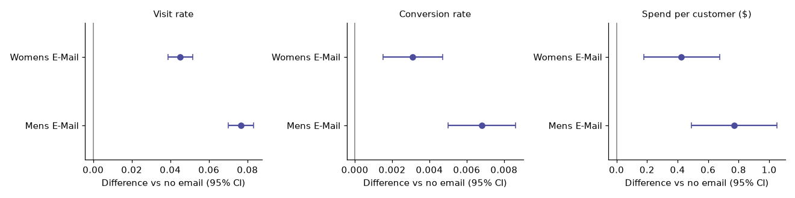

# Email A/B test: which email should the retailer send?

**Decision:** Should an online retailer send its customers a Men's email, a Women's email, or nothing, and is it worth the cost?
**For:** a head of e-commerce marketing.
**Data:** 64,000 customers randomly assigned to Men's email, Women's email or no email, with visits, conversions and spend measured over two weeks ([Hillstrom E-Mail Analytics Challenge](http://www.minethatdata.com/)).

## Answer
Send the **Men's email**. At a 40% margin and $0.05 per send it earns about **$0.26 per customer** (roughly $26,000 per 100,000 customers), and the whole decision interval is above zero.
The **Women's email** is real but marginal: about **$0.12 per customer**, with a lower bound of $0.002, so it flips to "don't send" if margin is around 30% or lower, or if a send costs $0.10 or more. Margin and send cost are assumptions the marketing team should replace with their own numbers, which is what the app is for.

| | Visit rate | Conversion | Spend per customer | Profit per customer* |
|---|---|---|---|---|
| No email | 10.6% | 0.57% | $0.65 | n/a |
| Women's email | 15.1% (+4.5 pts) | 0.88% | $1.08 (+$0.42) | $0.12 |
| Men's email | 18.3% (+7.7 pts) | 1.25% | $1.42 (+$0.77) | $0.26 |

*Margin 40%, $0.05 per email. All lifts are significant after Holm correction.



## What this project shows
- **Plan before results.** [research_plan.md](research_plan.md) fixes the hypotheses, metrics, decision rule and predictions before outcomes were analyzed.
- **Check the experiment before trusting it.** Sample-ratio check (p = 0.90) and covariate balance.
- **Statistically real is not the same as worth acting on.** The decision is made on incremental profit, not a p-value.
- **Honest handling of long-tailed spend.** Bootstrap intervals, since spend is mostly zeros.
- **Multiple comparisons.** Holm correction across the two emails; Bonferroni on the decision interval; six pre-chosen subgroup tests corrected together.
- **Predictions I got wrong.** Adjusting for past spend (CUPED) removed only 0.04% of variance, and one subgroup interaction survived correction narrowly. Both are reported as is.
- **Peeking simulation.** Checking a no-effect test daily and stopping at the first p < 0.05 gives a false win 21% of the time, not 5%.

## Run it
```
pip install -r requirements.txt
python src/download_data.py          # fetches the data (not redistributed here)
streamlit run app/Home.py            # explorer + power calculator
```
The analysis is in [notebooks/hillstrom_email_ab_test.ipynb](notebooks/hillstrom_email_ab_test.ipynb); reusable functions are in [src/ab.py](src/ab.py).

## Limits
Two-week window (no fatigue, unsubscribes or later cannibalization); revenue, not margin; margin and cost are assumed; a single 2008 campaign; intent-to-treat (we do not know who opened the email).

## Related
My Olist e-commerce analysis answers a retailer-style question from **observational** data. The comparison matters: Olist can show associations; this randomized test can show that the email caused the lift.
